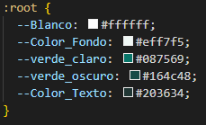

N.º | Requisito | Ubicación (archivo y línea o selector) | Hallazgo | Norma que incumple | Evidencia | Severidad (alta, media, baja)
---|---|---|---|---|---|---
1 | Base 5: Colores como variables | `css/estilos.css`, selector `:root` | Las variables no usan estrictamente el prefijo `--color-...` solicitado y mezclan mayúsculas con guiones bajos (ej. `--Color_Fondo`), en lugar de usar la convención *kebab-case* esperada (ej. `--color-fondo`). | Requisito Base 5 de la práctica y convención estándar de nomenclatura CSS. |  | Baja